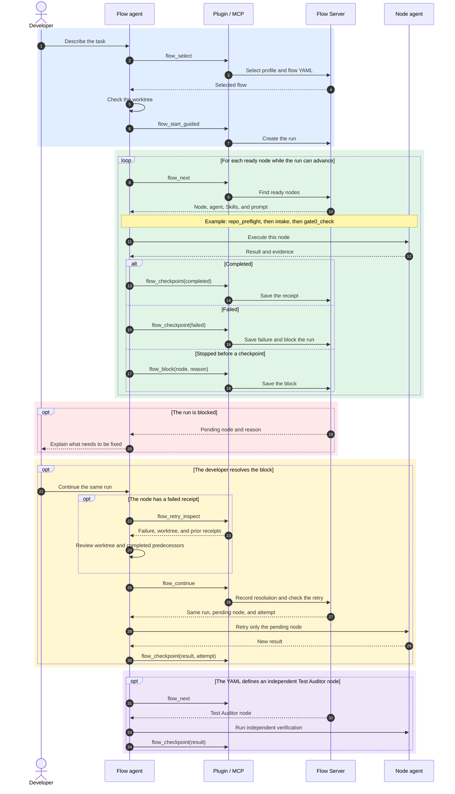

# flow-server

Public, local-first workflow service for YAML/JSON DAG flows, deterministic receipts, checkpoints, and audit.

This repository is in early development. It includes a runnable local service,
versioned public contracts, and synthetic fixtures only. It
deliberately contains no private flows, profiles, credentials, sessions, real
run evidence, company names, or dotfiles configuration.

The local HTTP API is documented in
[`contracts/v1/openapi.json`](contracts/v1/openapi.json). It is loopback-only;
every route that changes state requires the local service token and an
idempotency key.

The service does not emit telemetry, upload runs, or expose a non-loopback
bind. The local token is created with owner-only filesystem permissions in the
state directory.

This project is available under the [MIT License](LICENSE).

For a short, human-readable walkthrough, see the [quick guide in Portuguese](docs/guia-rapido.md).

See `openspec/changes/local-flow-service-product/` for the staged architecture and migration plan.

## Development

Requires Node.js 22 or newer.

```sh
npm test
npm run check:public
openspec validate local-flow-service-product --strict
```

## Local service (development)

Start the local service with its platform state-directory default:

```sh
node src/cli/flow-server.mjs start
node src/cli/flow-server.mjs status
node src/cli/flow-server.mjs doctor
node src/cli/flow-server.mjs stop
```

Use `--state-dir /absolute/path` to isolate local state during development and
`--port <1-65535>` to choose a loopback port. The development CLI provides no
adapter execution or Docker mode.

The `flow` client talks only to that local service:

```sh
node src/cli/flow.mjs list
node src/cli/flow.mjs start --flow hello-flow --workspace /absolute/workspace --runtime codex --mode guided
node src/cli/flow.mjs inspect <run-id>
node src/cli/flow.mjs audit <run-id>
```

Direct mode requires `--approve-host-adapter`; the current development build
still does not launch any adapter.

### Install local commands

Install the local development commands on macOS from this repository:

```sh
npm link
```

This makes `flow-server`, `flow-source`, `flow-mcp`, and the new `flow` client
available in your shell. Use the Herdr plugin and local MCP for new runs.

## External flows and adapters

External flows are opt-in. `FlowCatalog` accepts only directories that the
caller explicitly configures. It never searches `$HOME`; it validates compact
JSON flows and agent workflow YAML, including agent, model, effort, Skills,
prompts, conditions, dependencies, and stop rules. Flows with the same ID stay
separate in different profiles.

Codex and Claude are separate runtime contracts. Both support guided mode only
in this development build. Direct mode and adapter launch fail closed. No
adapter can run until a later approved change adds local authorization and a
host launcher.

Each local source may set `execution.runtime` to `codex` or `claude`, plus a
small `execution.models` map from flow model IDs to models available on that
machine. `execution.efforts` can translate a few effort values. The resolved
node settings are pinned in each run; the shared YAML stays unchanged. A
requested runtime that conflicts with the machine setting is rejected. See
[the quick guide](docs/guia-rapido.md) for a short example.

The Herdr plugin build checks for the known legacy runner. It validates and
copies flow YAML files before removing old entrypoints. Conflicts or unknown
files stop cleanup. Historical run logs are moved intact to
`~/.local/share/flow-server/legacy-runs` and are never read by the new service.

## Local MCP

`flow-mcp` lets Codex call the local flow service from a prompt. It uses stdio
and connects only to the loopback service. Setup instructions are in
[docs/codex-mcp.md](docs/codex-mcp.md).

Before a guided run, the Herdr pane checks the service, source, MCP registration,
and required Skills with `doctor`. It does not test model access or confirm that
the current agent session has loaded the MCP tools. The agent must see
`flow_list` before starting a run; after registering the MCP, open a new agent
session if the tools are absent. The pane starts the local service when it is
confirmed stopped. A blocked loopback connection or a lock owned by a live
process stops startup with an explanation; the plugin does not remove that lock.
See [the quick guide](docs/guia-rapido.md) for recovery steps.

## Local flow sources

Personal flows stay in explicitly configured local directories. A source may be
`local` or a local `git` worktree owned by the developer. `flow-server` never
searches `$HOME`, stores Git credentials, or requires a remote service.
Each developer chooses their own source path. A private repository can be used;
no repository name or hosting provider is built into the plugin.

### Herdr plugin

Install a published GitHub branch or tag with:

```sh
herdr plugin install andpeicunha/flow-server --ref <branch-or-tag> -y
```

For a local checkout, use:

```sh
herdr plugin link /absolute/path/to/flow-server --enabled
```

The plugin package includes the local service, CLI, schemas, Skills, and
starter flow. It does not install or activate private flows. Each developer
configures the directory containing their own flows after installation.

Open the `Flow Server` pane. On first use, choose an existing local flow
directory and an optional workspace directory. The plugin saves only source
metadata in `~/.config/flow-server/sources.json`, starts a loopback service, and
shows local flows and guided runs. It never starts an agent by itself. Use the
local `flow-server` MCP from your agent to advance a guided run and checkpoint
node output. See [docs/codex-mcp.md](docs/codex-mcp.md) for the MCP setup.

The old `flow-tui-bridge` is a legacy reference. Do not register or call it for
new runs.

Create an owner-only JSON or restricted YAML configuration. Use local workspace
roots to associate repositories with private profiles:

```yaml
schemaVersion: v1
sources:
  - id: personal
    mode: local
    path: /absolute/path/to/flows
    workspaceRoots:
      - /absolute/path/to/workspace
    sync:
      pull: confirm
      push: manual
```

For a private Git repository, point `path` to its checked-out flow directory
and set `mode: git`. You may also set `remote` and `branch` for that source.
Git synchronization is separate from flow execution: the plugin reads the
current checkout and does not pull remote changes automatically.

Start the service with the explicit file:

```sh
flow-server start --source-config /absolute/path/to/sources.yaml
```

Without `--source-config`, `flow-server start` uses
`~/.config/flow-server/sources.json`. `FLOW_SOURCE_CONFIG` overrides that
default. Startup rejects a missing file or a file with no profiles; `doctor`
also fails if the running service exposes no flows.

Validate and record a changed flow without performing any Git mutation:

```sh
flow-source validate /absolute/path/to/flow.yaml
flow-source mark --config /absolute/path/to/sources.yaml --source personal --file /absolute/path/to/flow.yaml
```

The runner selects a profile automatically only when one configured workspace
root matches uniquely. It selects a flow automatically only from an explicit
flow ID or when exactly one flow matches routing terms. Otherwise, the CLI or MCP
`flow_select` returns `needs_confirmation`; the agent must ask the developer
before starting. `flow_next` then returns ready nodes with the exact configured
agent, model, effort, executor, Skills, constraints, and prompt. The agent
records bounded structured output in node receipts so later conditions can run.
The first `flow_next` starts the run. It marks the run complete when all required
nodes finish; the CLI lifecycle command controls an active run.
The CLI audit command reports `passed` only for a completed run with evidence for every
required node.
For a failed node, the agent reviews predecessor evidence and the pinned
worktree with `flow_retry_inspect`, then uses `flow_continue`. The service
archives the failed attempt and returns only that node with a new attempt
number. Completed nodes stay unchanged. See the [quick guide](docs/guia-rapido.md).
If a ready node cannot run before a receipt is saved, `flow_block` records its
reason and pending node. After the developer fixes the issue, `flow_continue`
records the resolution and returns that node in the same run. `flow_next` also
records blocks found in dependencies. A stopped run keeps its stop rule in
`flow_inspect`, so the developer can see why it ended.

Set `mode: block` on a `stopWhen` rule when the developer can fix its result.
After the fix, the agent checks the pinned worktree and earlier nodes, then
calls `flow_continue`. The service keeps the old receipt in the attempt history
and returns the same node with a new `attempt`. The next node stays locked until
the new checkpoint satisfies the rule. Without `mode: block`, a stop rule ends
the run as before.

### Per-source runtime fallback

A machine can allow one fallback runtime in one source. For example, this
source starts with Claude and can switch a node to Codex:

```json
"execution": {
  "runtime": "claude",
  "fallback": {
    "runtime": "codex",
    "models": {
      "anthropic/primary-model": "openai/gpt-6.1-terra",
      "anthropic/review-model": "openai/gpt-6.1-sol"
    },
    "agents": { "explorer": { "model": "openai/gpt-6-luna", "effort": "low" } }
  }
}
```

Sources without `fallback` cannot switch runtimes. The allowed models are pinned
when a new run starts. `flow_next` records and returns the selected runtime,
model, effort, and attempt for each ready node. The receipt must match them.
After a real provider limit, call `flow_block` with `reasonCode: "RATE_LIMIT"`.
Inspect the node and its predecessors with `flow_retry_inspect`, review partial
work in the pinned worktree, then call `flow_switch_runtime` with the node ID,
workspace, reason, worktree review, and `reviewedPredecessors: true`. The same
run returns that node on the fallback runtime with a new attempt. The switch
stays in the run audit. A provider limit is not a completed checkpoint.

Capacity estimates and automatic switching are not part of this phase.

For the full sequence in plain language, see the [quick guide](docs/guia-rapido.md).

### Guided run sequence

The green section repeats for each ready node in the flow YAML. The server
tracks progress; the agent does the work. Colors show setup (blue), node work
(green), a block (red), continuation (yellow), and optional independent
verification (purple).



The Test Auditor runs only when the flow YAML defines that node. A `stopped`
run is final; `flow_inspect` shows which stop rule ended it. Existing runs keep
their pinned YAML definition when the server is updated.

The installed `flow-source-management` Skill defines safe commit, push, pull,
and rollback behavior. Pull always requires confirmation. The optional remote
catalog, VPS, Caddy, Cloudflare, and WorkOS deployment are paused and are not
required for local sources.

## Low-cost run evidence and flow review

Node receipts may record bounded duration, attempt, declared agent/model,
effort, optional runtime token counts (`tokenUsage.inputTokens` and
`tokenUsage.outputTokens`), Skills, deterministic validation, and passive review signals. Missing token counts are unknown; the service cannot verify the runtime source. Signals
are advisory and must set `affectsRun: false`; they never change an active run.

An explicit post-run review uses only local deterministic aggregation.

The maintainer requests this review in a separate session. The agent calls
`flow_review` through the local MCP and uses the `flow-performance-review`
Skill to interpret the report. The CLI is also available:

```sh
node src/cli/flow.mjs review sdd --last 20 --compare-versions
node src/cli/flow.mjs review sdd --since 2026-10-01T00:00:00Z
node src/cli/flow.mjs review sdd --content-hash <sha256>
```

The report is stored under the newest matching run at
`runs/<runId>/review/flow-review.json`. It references the analyzed run IDs and
groups evidence by flow content hash. It does not call a model. The installed
`flow-performance-review` Skill tells an independent agent how to interpret the
report and propose a separate, approved flow change.

When a run has an immutable flow snapshot, the report compares expected nodes
with stored receipts. Older runs without a snapshot are marked with unknown
evidence completeness. Evidence beyond the bounded software-flow limits is
rejected instead of producing an oversized report.

## Remote catalog MCP (V2 development)

`flow-remote-mcp` is separate from the local `flow-mcp` bridge. It has only
versioned-flow catalog and safe run-analysis tools. It cannot run agents, use a
shell, access a workspace, or publish a flow.

For local protocol development, create an explicit JSON catalog file with a
`releases` array. Each release must set `approved` to `true`. Set its absolute
path and a unique bearer token with at least 16 characters, then start the
stdio server:

```sh
export FLOW_REMOTE_MCP_BEARER_TOKEN="replace-with-a-unique-development-token"
export FLOW_REMOTE_MCP_CATALOG_FILE="/absolute/path/to/approved-releases.json"
export FLOW_REMOTE_MCP_DATA_FILE="/absolute/path/to/remote-catalog-state.json"
flow-remote-mcp
```

The remote transport must pass this value as `Bearer <token>` in the MCP request
authorization context. Do not put this token in a flow definition, prompt,
repository, or log. The data file stores only validated, redacted evidence,
analyses, and `pending_review` proposals. It never stores release definitions,
prompts, workspace paths, file bodies, tokens, secrets, or full agent output.
Use a dedicated writable directory for this one file. The release file stays
read-only. A VPS deployment and WorkOS OAuth are not included yet.

### Profile tool policy

A source can opt into `policy`; existing sources without it keep their previous behavior. Rules match full names without case sensitivity. `*` matches any number of characters, and a leading `!` denies a match even if another rule allows it. An omitted list is unrestricted; an empty list denies that tool type. Nonempty lists need at least one positive rule. Names are not proof of ownership and do not prevent calls outside flow-server.

```json
{"schemaVersion":"v1","sources":[
  {"id":"product-a","mode":"local","path":"/path/to/a/flows","sync":{"pull":"confirm","push":"manual"},"policy":{"skills":["*","!*product-b*"],"mcps":["*","!*product-b*"],"mcpRegistrations":{"design-tools":{"codex":"design-a","claude":"design-a-claude"}}}},
  {"id":"product-b","mode":"local","path":"/path/to/b/flows","sync":{"pull":"confirm","push":"manual"},"policy":{"skills":["test-evidence-audit"],"mcps":[]}}
]}
```

Declare each node's logical MCPs explicitly, including dependencies of its Skills:

```yaml
nodes:
  - id: review
    agent: reviewer
    skills: [design-review]
    mcps: [design-tools]
```

Both logical and runtime registration names must pass the MCP rules. Missing mappings use the logical name. The bridge is checked separately. Validate a file with its profile using `flow-source validate flow.yaml --config /path/to/sources.json --source product-a`. New runs reload the source and policy; active runs retain their pinned flow. Agents must use only tools declared by their node and allowed by the active profile.
