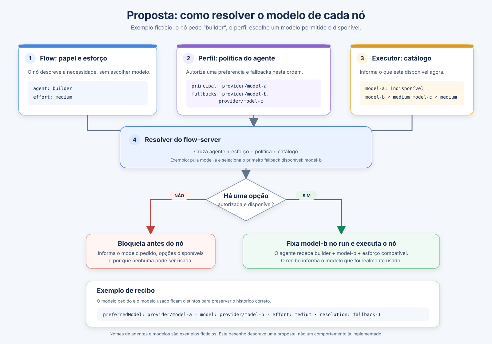

# Proposta: resolução de modelos por agente

> Este documento descreve uma proposta em discussão. O fluxo abaixo ainda não representa um comportamento implementado.

O flow declara o papel (`agent`) e o esforço desejado. O perfil local associa cada agente a um modelo principal e a uma lista ordenada de fallbacks permitidos. O executor informa quais modelos estão disponíveis. Antes de iniciar cada nó, o flow-server cruza essas informações e fixa a primeira opção autorizada e disponível no run.



## Exemplo prático

O flow pede `agent: builder` com `effort: medium`. O perfil define `provider/model-a` como principal e `provider/model-b`, depois `provider/model-c`, como fallbacks autorizados. O catálogo informa que `model-a` está indisponível, mas `model-b` e `model-c` estão disponíveis. Como `model-b` vem primeiro, o resolver fixa esse modelo no run antes de o agente executar o nó.

O recibo deve registrar o modelo efetivamente usado e preservar a diferença em relação ao modelo preferido pelo perfil:

```json
{
  "preferredModel": "provider/model-a",
  "model": "provider/model-b",
  "effort": "medium",
  "resolution": "fallback-1"
}
```

Se nenhum modelo autorizado estiver disponível, ou se o executor não fornecer um catálogo verificável, o nó é bloqueado antes da execução e o diagnóstico explica a causa. O perfil é a fonte da política de modelos e da ordem de fallback; o flow não escolhe nem autoriza modelos.

Todos os nomes de agentes e modelos deste exemplo são fictícios. Não há nomes de empresas ou repositórios.
